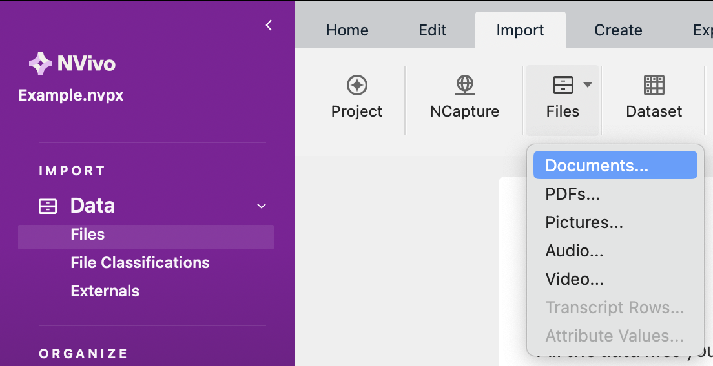
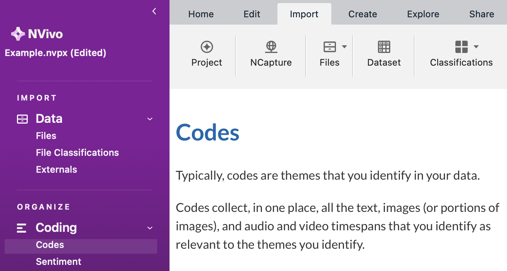
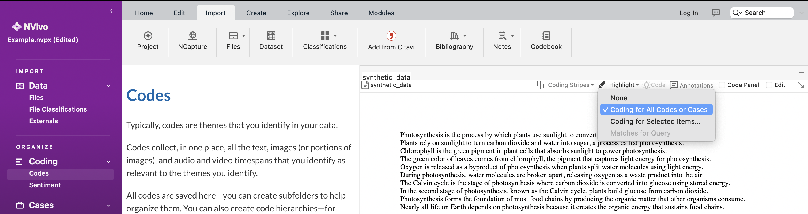
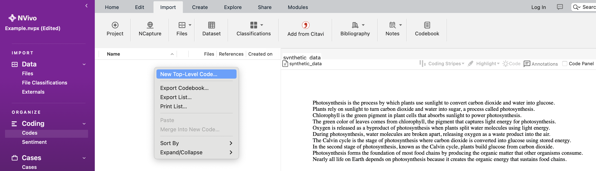
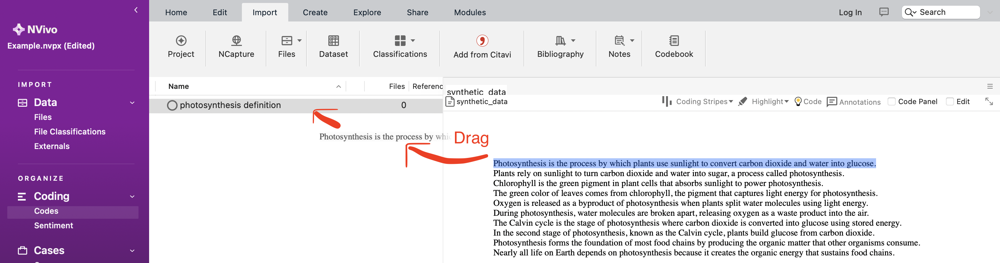
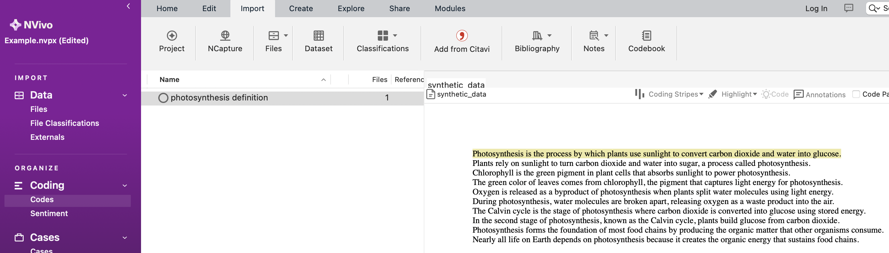
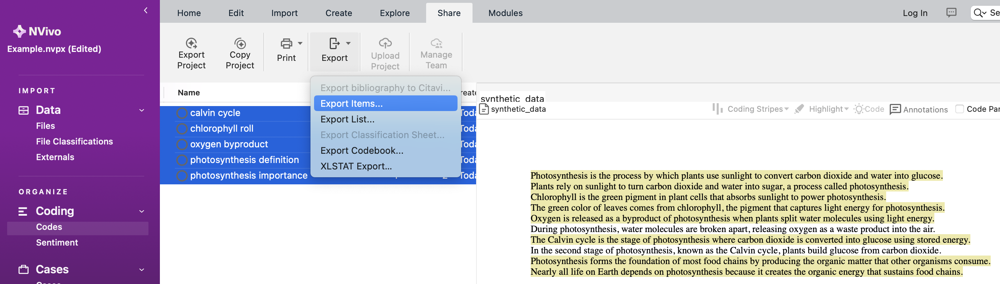
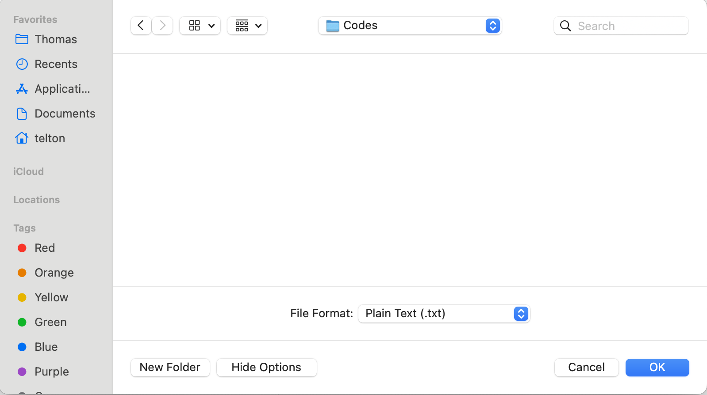
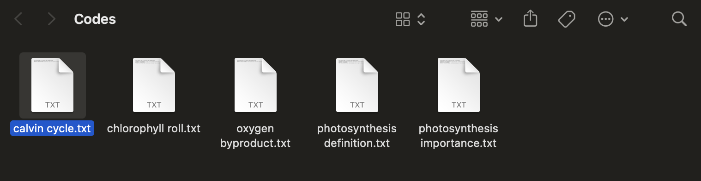

# Process for Clustering in NVivo

To do the clustering, we will be using NVivo. At the time of writing, staff at the University of Sydney can use NVivo for free (see the Service Portal).

> Note (if other people may stumble on this repo). When making this tutorial, I forgot that the python script as it exists works for a very specific circumstance. It assumes that there is a primary key in brackets at the end of the sentence. For example, "This is a sentence. (1)". If it does not follow this format, the code will break. With that being said, the example below does not work, but should be sufficient for my supervisor reading this (our data does have the primary key at the end in brackets).

1. Create a new NVivo file. When open, go to Import > Files > Documents, and then find the txt file (or document) you want to upload and press "Import".



2. Navigate to the Codes tab.



3. Ensure that you switch highlighting to be "Coding for All Codes or Cases".



4. Look at the sentences, and think about what the first cluster is and what it should be named. Once you have decided, in the left-hand strip, right-click and press "New Top-Level Code...". Give that code a name.



5. Highlight the sentence(s) you want to include in that code and drag them into the code on the left. You can highlight a single sentence, or a block of consecutive sentences in one go. Because the text file is semantically sorted, similar responses often sit next to each other (e.g. a run of "no", "nothing" and "none" responses), so dragging them as one block is much faster than dragging them one at a time. When highlighting a block:

   - Highlight whole lines. Start at the first character of the first sentence and finish after the closing bracket of the last sentence's key, e.g. `(110)`. Every line in the block must end with its key.
   - Only include sentences that belong in that cluster. If a sentence in the middle of a run doesn't belong, end the block before it and start a new block after it.
   - Don't include a sentence that is already in another code. Each sentence must be in exactly one code. The python script will stop and list any sentence that is in more than one code.



Once a sentence has been clustered, it will be highlighted yellow.



6. Continue the clustering process. This is my process:

- Go through all the sentences first, and make a new cluster any time I see that two sentences will belong together. When doing this, I purposefully leave sentences that do not belong in a cluster by themselves.

- Scroll up to the top of the text file for a second pass. This time, I only look at the sentences that are not highlighted yellow. If they are not highlighted yellow, this means that I missed that sentence in my first pass. I will now see if I can add those sentences to an existing cluster, or if I should create new clusters to contain sentences that should be together. If it is obvious that a sentence will be in a solo cluster, then it is fine to not create a new cluster in NVivo for it. They python script later will manually make clusters for left-over sentences. This behaviour is intended so that the codes in NVivo are more manageable.

7. When you are done, in the panel that shows all the codes, press command+A (or control+A) to select all the clsuters (they should be highlighted blue when selected).

8. Navigate to Share > Export > Export Items... (NB: in the clustering example in the iamges, I have intentionally made mistakes in the clustering to illustrate the notion of leaving sentences by themselves)



9. I recommend making a new folder called Codes to contain the NVivo output. Click on "Show Options" and set the file format to "Plain Text (.txt)". When finished, press "Ok".



10. The output from step 9 creates a text file for each code in NVivo.



11. Now you are ready to run the python script to generate a csv file. To run the python script, enter `python3 generate_csv_NVivo_clustering.py "<text_file_uploaded_to_NVivo.txt>" --codes-dir "<directory_to_get_to_codes_from_step_9>" --csv-output "<file_name_for_produced_csv.csv>"`

## How the script reads the NVivo export

NVivo exports each code as a text file. Each time you drag a highlight into a code, NVivo records it as a *reference*, and each reference sits under a `Reference N - x% Coverage` header. A reference holds one line if you dragged a single sentence, or several lines if you dragged a block:

```
Reference 1 - 0.13% Coverage
No specific confusion in this lecture. (23)
Reference 2 - 0.54% Coverage
no (96)
no (97)
No (98)
...
Nothing as such (110)
```

The script treats every line under a reference as its own sentence and uses the key in brackets to identify it, so the example above puts sentences 23 and 96 to 110 in the cluster. Codes made the original way (one sentence per reference) still work and give the same CSV as before.

The CSV has one row per sentence in the sorted text file, with the columns `Code_Name` and `Quote`. The quote is always taken from the sorted text file rather than from the NVivo export, because NVivo changes straight apostrophes (') to curly ones (’). Any sentence that isn't in a code becomes its own cluster, named after its first 40 characters. If two of these sentences start with the same 40 characters, the key is added to the second name so they stay as separate clusters.

Before writing the CSV, the script checks the codes. It stops without writing the CSV and lists the problems if:

- a line in a code doesn't end with a key like `(N)`. This usually means the highlight stopped before the end of the last line in a block.
- a sentence is in more than one code. This usually means a block overlapped a sentence that was already coded.
- a key in a code isn't in the sorted text file. This usually means the wrong sorted text file or codes folder was passed to the script.

Fix these in NVivo, export the codes again (steps 7 to 9) and re-run the script.

The script also prints a warning, but still writes the CSV, if a coded line is only part of a sentence (e.g. the highlight started partway through the first line of a block). The full sentence from the sorted text file is used in the CSV, but it is worth checking the highlight in NVivo.

